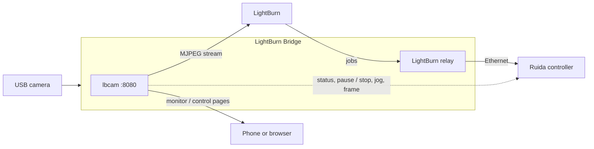

<div align="center">

# BridgeDeck

**Camera, live job monitor and phone remote for the LightBurn Bridge.**

Plug a USB camera into the Bridge and use it in LightBurn over WiFi, then watch and steer
your laser from any phone or browser on the network.

[](https://github.com/Agame7k/lightburn-bridge-camera/actions/workflows/ci.yml)
[](https://github.com/Agame7k/lightburn-bridge-camera/releases)


[](LICENSE)

[Quick start](#quick-start) · [Features](#features) · [Docs](#documentation) · [Changelog](CHANGELOG.md)

</div>

> [!NOTE]
> **Unofficial.** Not affiliated with or endorsed by LightBurn Software. It runs as a separate
> service next to the Bridge's own software and doesn't modify LightBurn's code. LightBurn's
> Bridge image is not included; you patch your own copy.

<!--
Screenshots: put PNGs in docs/images/ and uncomment.
<p align="center">
  
  
</p>
-->



## Features

### 📷 Network camera for LightBurn
- **MJPEG stream and snapshot URLs** that LightBurn's network camera option accepts, so
  overlay, Print and Cut and alignment all work.
- **Setup page** with live preview, camera / resolution / frame-rate pickers that show what the
  camera really supports, and image controls (exposure, focus, white balance…) saved per camera.
- Serves a *Camera not connected* image instead of a dead stream, and recovers on its own
  when the camera is plugged back in. Idles the camera when nobody is watching.

### 📊 Monitor page — leave it open next to the laser
- Job status straight from the controller: running / paused / idle, progress, elapsed time,
  head position, machine counters and hours.
- **Job drawing**: the file LightBurn sent, drawn by layer colour, with the finished part and the
  laser head marked live. The last 10 jobs and how each run ended.
- **Alerts** for job started / finished / stopped at N%, laser or camera disconnected, Bridge
  hot or under-voltage, and *laser isn't firing* (usually a water or door alarm).
- Bridge health: CPU temperature, throttling, load.

### 🎮 Control page — your phone as a pendant
- Jog pad with diagonals, step sizes and speed like LightBurn's Move window, **Move to X/Y**,
  **Home**, **Go to origin**, **Frame** and **Outline frame**.
- **Pause / Resume / Stop** always within thumb reach.
- Every move is laser-off, limited to the bed size read from the controller, and stoppable.
  There is deliberately no way to start a job or fire the laser.

### 🔧 Built to be left alone
- **No dependencies**: pure Python 3.7 standard library, runs on the stock Bridge image.
- Starts at boot and survives crashes and camera unplugs.
- **Safe updates from the browser**: each update self-tests on the Bridge, is health-checked
  after restart and **rolls back automatically** if it fails. Optional update password.
- Static IP for the Bridge's WiFi, with a 90-second "keep these settings?" safety net.

## Quick start

**You need:** a LightBurn Bridge (tested with the **v1.0-RC4** image), a USB **UVC camera with
MJPEG output** (nearly every camera sold for LightBurn), and LightBurn with network camera support.

### 1. Install

**Option A — patch the Bridge image and flash it** (Linux, needs `e2fsprogs` and Python 3; no root):

```bash
python3 patch_image.py LightBurnBridge-v1.0-RC4.img.xz LightBurnBridge-camera.img
```

Flash `LightBurnBridge-camera.img` with Raspberry Pi Imager (*Use custom*), then set the Bridge up
as usual. The original image is left untouched.

**Option B — install on a running Bridge over SSH:**

```bash
./upgrade_over_ssh.sh <bridge-ip>
```

Asks for the Bridge's SSH password once (stock image: user `pi` — please change it, see
[Security](SECURITY.md)).

### 2. Connect LightBurn

In LightBurn's camera settings choose a **network camera** and enter:

| | URL |
|---|---|
| MJPEG stream (recommended) | `http://lightburnbridge.local:8080/stream` |
| Snapshot | `http://lightburnbridge.local:8080/snapshot.jpg` |

The `.local` name survives IP changes (built into macOS; Windows/Linux need mDNS/Bonjour).
Otherwise use `http://<bridge-ip>:8080/stream`. Then run *Calibrate Camera Lens* and
*Align Camera* — and again whenever you change camera or resolution.

### 3. Open the pages

| Page | URL | For |
|---|---|---|
| Setup | `http://lightburnbridge.local:8080/` | camera settings, URLs, logs, network, updates |
| Monitor | `http://lightburnbridge.local:8080/monitor` | watching a job |
| Control | `http://lightburnbridge.local:8080/control` | jogging and framing from a phone (add it to your home screen) |

## Documentation

| | |
|---|---|
| [Laser control and job capture](docs/laser.md) | what each button sends, how status is read, how jobs are captured and framed |
| [Updates and rollback](docs/updates.md) | building and installing updates, where files live on the Bridge |
| [Static IP](docs/static-ip.md) | giving the Bridge a fixed WiFi address |
| [HTTP API](docs/api.md) | every endpoint, for scripting |
| [Troubleshooting](docs/troubleshooting.md) | what the messages on each page mean |
| [Contributing](CONTRIBUTING.md) | running it locally, tests, project layout |
| [Security](SECURITY.md) | threat model and reporting vulnerabilities |

## Compatibility

| | Status |
|---|---|
| Bridge image v1.0-RC4 | ✅ tested |
| Ruida RDC6442G | ✅ status, pause / resume / stop, jog, home, origin, frame verified |
| Other Ruida controllers | 🟡 probably; `/api/laser` shows the raw values — please [report](https://github.com/Agame7k/lightburn-bridge-camera/issues/new/choose) |
| Non-Ruida controllers | ❌ camera works, laser features don't |

## License

[MIT](LICENSE). LightBurn is a trademark of LightBurn Software, LLC.
